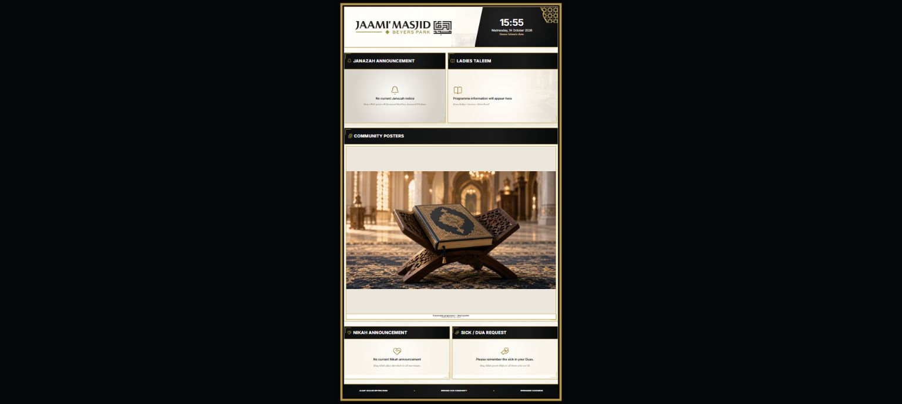
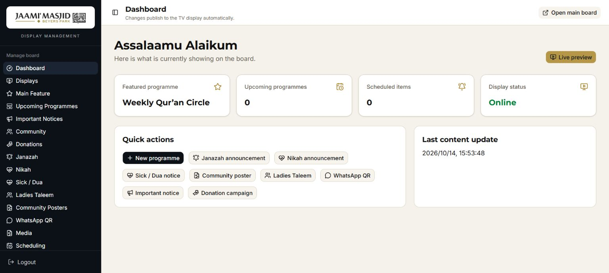
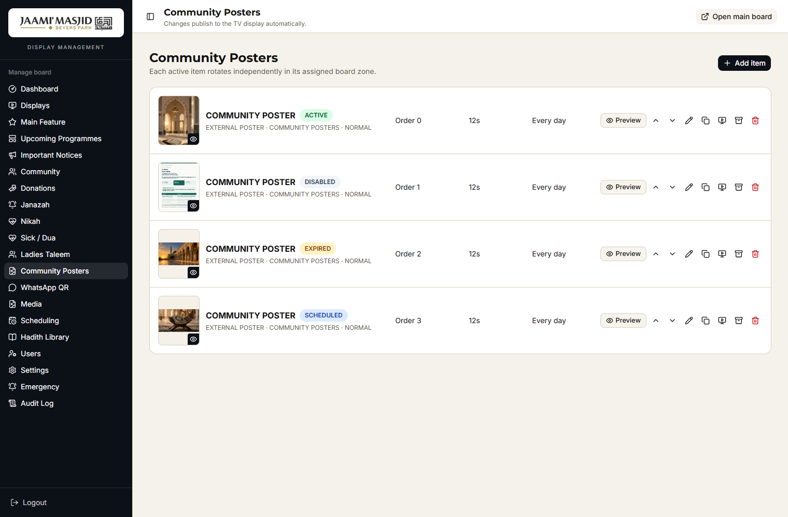
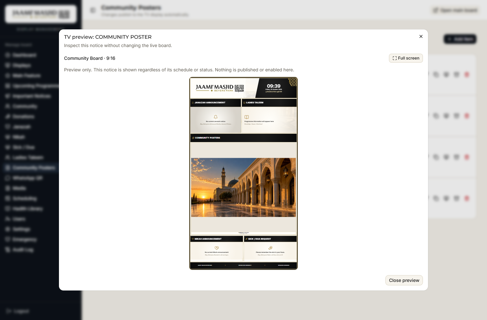

# Jaami' Masjid Digital Display Board

A digital noticeboard with landscape and portrait display profiles, a password-protected admin portal, persistent media storage, and preserving-data Windows upgrades.

See the [changelog](CHANGELOG.md) for the latest changes, verification and security review notes.

## Screenshots

These screenshots were captured from an isolated local demo on 14 October 2026. Programme wording, poster content, dates and QR destinations are samples. They do not show a production database or verified upcoming events.

### Main landscape board


The 16:9 Main Board shows a featured programme or notice, rotating information panels, donation and WhatsApp details, a live clock and the bottom ticker/hadith area. Open `/display/main` on the landscape display PC.

### Community portrait board



The 9:16 Community Board groups Janazah, Nikah, sick/dua, Ladies Taleem and community posters. Empty panels clearly say when there is no current notice. Open `/display/community` on the portrait display PC.

### Administration dashboard



Sign in at `/admin/login`. The sidebar opens management sections, and quick actions create programmes and notices. The admin sees all records, including drafts and archived content; public displays receive only eligible published records. Editor accounts are restricted to their permitted content, media and hadith actions.

### Preview notices before applying changes

- In **Community Posters**, click a poster thumbnail or its **Preview** button to inspect it in the complete TV layout. Images have thumbnails; PDFs show their first page. Paused, expired and scheduled items can be previewed without changing their status.
- In a notice's create/edit window, choose **Preview on TV** to inspect the current unsaved wording and uploaded file. **Back to editing** keeps your changes; **Save item** remains the separate action that applies them according to the notice's status and schedule.
- **Full screen** enlarges the preview. Main uses the landscape layout and Community uses the portrait layout. A preview explains when a selected profile/zone has no matching TV slot.
- Hover over an action icon, or reach it with the keyboard, to see a readable label such as **Edit notice**, **Make a copy** or **Pause on TV**. Labels describe the current action, including **Enable on TV** and **Restore from archive**. Unavailable controls are labelled as unavailable.

Previewing does not save or enable a notice. Uploaded files are stored in Media as before, but uploading alone does not put a notice on the TV. Preview snapshots stay in the signed-in browser and are not placed in URLs or browser storage. Existing **Displays / Live preview** continues to show published content.

This feature adds no database migration. Use the preserving-data Windows upgrade below for an existing server.

The following examples use an isolated demo database captured on 16 October 2026. They do not show live notices.





## How the app works

The Windows server runs the application, D1 database and R2 upload storage locally. Display PCs open the server's display URL in a browser; they do not need to run Node.js or hold the database. Admin changes are saved on the server and the display pages poll for updated published content.

GitHub stores the application source and documentation. Downloading or cloning this repository does not start the board server. Follow the installation or upgrade instructions below on the server PC.

| Item | Purpose |
| --- | --- |
| `/admin/login` | Administrator/editor sign-in |
| `/display/main` | Landscape Main Board |
| `/display/community` | Portrait Community Board |
| `.env` | Local credentials and session secret; never commit it |
| `.board-data` | Persistent database and uploaded blobs; retain it during upgrades |
| `.board-runtime` | Server process record and diagnostic logs |
| `backups` | Verified rollback snapshots, including credentials; keep them private |

## Existing server: safe upgrade

1. Download the repository using **Code → Download ZIP**, or use a prepared update ZIP.
2. Extract outside the existing installation, for example to `C:\JaamiMasjidBoard-Update`.
3. Open the extracted package folder containing `UPGRADE-WINDOWS.cmd` and run it as administrator.
4. Wait for **Upgrade complete**, sign in again with the existing password, and check both displays.

The default installed location is `C:\JaamiMasjidBoard`. The upgrader requires the existing configuration and data folder, creates a mandatory SHA-256-verified backup, preserves credentials/database/uploads, and applies a repeatable additive schema upgrade. It retains legacy schedule data. It stops on failure and prints the rollback snapshot path.

For a different installed location, run from an Administrator PowerShell window in the extracted package folder:

```powershell
.\scripts\windows\Upgrade-Board.ps1 -InstallPath "D:\JaamiMasjidBoard"
```

Do not delete the old installation or copy another server's `.env` or `.board-data` into it. See [the complete upgrade and recovery guide](UPDATE-EXISTING-WINDOWS-SERVER.txt) before restoring a backup.


## Quick start with Docker (optional)

1. Copy `.env.example` to `.env`.
2. Change `ADMIN_PASSWORD` and `SESSION_SECRET` in `.env`.
3. Start the system:

   ```powershell
   docker compose up -d --build
   ```

4. Open:

   - Display: <http://localhost:3000/display>
   - Admin: <http://localhost:3000/admin/login>

Stop the system with `docker compose down`. Database records and uploaded media are kept in the Docker volume.

## Windows 11 one-click installation

For a new installation, extract into **`C:\JaamiMasjidBoard`** on the Windows system drive, then double-click **`INSTALL-WINDOWS.cmd`** and accept the administrator prompt. The automatic service refuses custom/user-profile locations and linked paths. The installer:

- installs Node.js LTS when required and ensures the Microsoft Visual C++ x64 runtime used by Cloudflare's local server is present;
- asks you to create the initial admin username and password;
- installs dependencies, builds the production app and prepares its database;
- protects installation permissions and registers a LocalService background task that starts with Windows;
- opens TCP port 3000 to devices on the local subnet;
- starts the board immediately, without requiring a reboot or Docker Desktop.

Nothing opens on the server PC. On the separate television/display PC, open:

```text
Main landscape board:     http://SERVER-IP:3000/display/main
Community portrait board: http://SERVER-IP:3000/display/community
```

The admin page is `http://SERVER-IP:3000/admin/login`. HTTP login is retained by request and remains unencrypted. The installer prints server addresses and preserves existing credentials/data. Use administrator PowerShell for maintenance. See the [security review](docs/SECURITY-REVIEW.md) for deployment checks and HTTPS alternatives.

To remove the Windows autostart service and firewall rule, double-click **`UNINSTALL-WINDOWS.cmd`**. It retains the application, database, uploads and backups.

## Upgrading an existing Windows server

Read [START-HERE-UPDATE.txt](START-HERE-UPDATE.txt) and the [security review](docs/SECURITY-REVIEW.md). The [older printable guide](docs/Windows-Update-Guide.pdf) covers the original preserving-data workflow; current text instructions take precedence for security changes.

To update a server that already runs the board, build an update ZIP from the new source with **`PACKAGE-WINDOWS.cmd`** (or `scripts\windows\Package-Board.ps1`). On the server, extract the ZIP to a temporary folder and run **`UPGRADE-WINDOWS.cmd`** as administrator. Extract outside the existing installation. The upgrade requires the existing `.env` and `.board-data`, stops the service, creates a mandatory SHA-256-verified backup of credentials, data, uploads and the previous app/build, then copies new app files in place. It preserves runtime paths, rebuilds, applies a repeatable additive schema upgrade and restarts the service. Legacy admin sessions require sign-in again; accounts and passwords are retained. A failed update reports the rollback snapshot and keeps the service stopped after app replacement.

See `UPDATE-EXISTING-WINDOWS-SERVER.txt` for the full steps and a manual fallback. Re-running `INSTALL-WINDOWS.cmd` over an existing installation also preserves credentials and board data.

## Packaging a release

`PACKAGE-WINDOWS.cmd` (or `scripts\windows\Package-Board.ps1`) creates `outputs\JaamiMasjidBoard-Update-<timestamp>.zip` containing the application source, scripts and assets, while excluding `node_modules`, build output, `.git`, `.env` and all runtime data. Extract it on a server and run `UPGRADE-WINDOWS.cmd` (existing install) or `INSTALL-WINDOWS.cmd` (new PC).

## Automatic second-monitor display client

Copy the `display-client` folder to each separate display PC and double-click:

```text
INSTALL-DISPLAY-CLIENT.cmd
```

Enter the server IP address and choose Main (landscape) or Community (portrait) when prompted. This client does not install the application or Node.js. It verifies the server, detects the first non-primary monitor, and registers a profile-specific per-user logon task. At every sign-in it waits for both the server and second monitor, then keeps Microsoft Edge in fullscreen kiosk mode on that second screen.

The launcher uses its own Edge profile so an already-open personal Edge window does not absorb or reposition the display. Rerun the installer to change the server address. Use `UNINSTALL-DISPLAY-CLIENT.cmd` to remove the display-PC task and its dedicated browser profile.

## Manual Windows 11 setup

Install Node.js 22 LTS, then run PowerShell in this folder. Docker Desktop is not required:

```powershell
.\scripts\windows\Setup-Board.ps1
```

Windows helpers are included for maintenance and manual operation:

```powershell
.\scripts\windows\Start-Board.ps1
.\scripts\windows\Start-Kiosk.ps1
.\scripts\windows\Backup-Board.ps1
.\scripts\windows\Stop-Board.ps1
```

The Windows service keeps the D1 database and uploaded media under `.board-data` and writes runtime logs under `.board-runtime`. `Start-Kiosk.ps1` is an optional helper for a display computer and is not registered on the server. To use Docker Desktop instead, run `.\scripts\windows\Setup-Docker.ps1 -OpenDisplay`.

## Islamic date

Both display profiles use the South African Islamic date published by Jamiatul Ulama KZN. The board refreshes the date every four hours and keeps the last successful value if the source is temporarily unavailable. Administrators can select **Manual override** under **Admin → Settings → Islamic date source** when a local moon-sighting correction is required.

## Local development

Requires Node.js 22.13 or newer.

```powershell
npm install
npm run db:migrate:local
npm run dev
```

## Environment variables

| Variable         | Purpose                             | Initial value             |
| ---------------- | ----------------------------------- | ------------------------- |
| `ADMIN_USERNAME` | Administrator login name            | `admin`                   |
| `ADMIN_PASSWORD` | Initial administrator password      | Required: unique, 12–1024 characters |
| `SESSION_SECRET` | Signs session tokens (HMAC-SHA256)  | Required: random, at least 32 characters |

The first login creates the initial administrator from `ADMIN_USERNAME` / `ADMIN_PASSWORD`; placeholders are rejected. Changing `ADMIN_PASSWORD` later does not overwrite the stored account. Keep `ADMIN_USERNAME` unchanged on existing installations. Docker Compose mounts `.env` read-only. Setup helpers quote values safely; manual `.env` edits must account for Wrangler's dollar-variable expansion.

Passwords are stored as PBKDF2-SHA256 hashes with a unique random salt per user (format `pbkdf2$sha256$<iterations>$<salt>$<hash>`). Accounts created by older builds are upgraded automatically the next time they sign in. `SESSION_SECRET` no longer salts password hashes, so rotating it only invalidates active sessions — users sign in again rather than being locked out.

## Database and migrations

The D1 schema is maintained in two places that must be kept in step:

- `lib/schema-upgrade.ts` owns the additive, inspected schema upgrade. `lib/server-schema.ts` runs it at runtime; `scripts/migrate-board.mjs` runs the same upgrade through local Wrangler for Windows, Docker and development setup. Repeated runs skip existing columns and retain existing tables, including legacy schedules. Local upgrades do not replay historical SQL or modify the historical migration ledger.
- `drizzle/` retains versioned SQL for hosted migration workflows. New schema changes must also have a migration for those workflows. Do not blindly replay historical migrations on a database already initialized by runtime; migration `0005` historically dropped schedules.

Session `user_id` is added without backfilling legacy sessions from usernames. This requires existing browsers to sign in again and prevents an old cookie from inheriting an account that reused its username.

## Display operation

Open `/display/main` (or the compatible `/display` alias) for the 16:9 Main Board. Open `/display/community` for the 9:16 Community Board. Both routes refresh published content automatically without a page reload and retain the last valid state during a temporary connection failure.

Use the same admin portal to target content to either board and manage featured content, programmes, announcements, notices, Ladies Taleem, community posters, WhatsApp QR details, donation details, uploaded media, display scheduling, and system settings. Draft or future-scheduled content is not shown until it becomes active.


## If admin and display both stop responding

Check the server PC is powered on and the address/port are correct. If the PC is on, capture diagnostics before reapplying an update, since an update restarts the service and can hide evidence of the earlier failure.

On the server, open PowerShell as Administrator and run:

```powershell
powershell.exe -NoProfile -ExecutionPolicy Bypass -File "C:\JaamiMasjidBoard\scripts\windows\Diagnose-Board.ps1"
```

Replace the installation path when necessary. This read-only script reports the scheduled task, local HTTP response, listening process, recent logs, build/data presence and firewall rules. Use the task result and logs to distinguish a stopped server, a nonresponding process, a database error and a network problem. The current service runner has a finite restart policy; a historical freeze cannot be diagnosed from a successful reinstall alone.

## Verification

```powershell
npm test
npx tsc --noEmit
npm run build
powershell.exe -NoProfile -ExecutionPolicy Bypass -File tests/windows-upgrade-smoke.ps1
```

The Windows smoke test uses isolated fixtures and mocked service controls. It checks successful updates, failed installers, missing credentials, preservation of database/hidden blobs/uploads/configuration, and a verified rollback snapshot. It does not upgrade a live installation.

Keep real credentials, personal notices, uploaded media, backups and runtime data out of GitHub. The repository includes `.env.example` as a template; create the actual `.env` locally.
